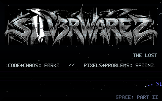
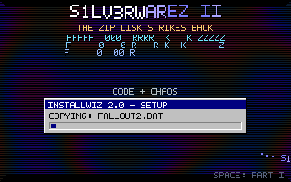
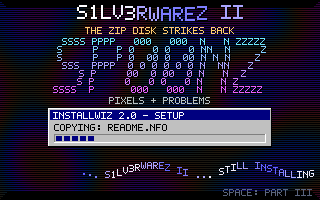
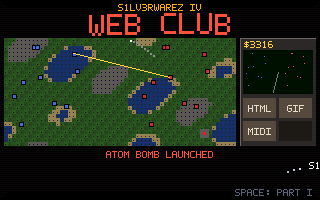
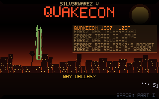

# S1LV3RWAREZ — The Lost Cracktro

A deliberately anachronistic cracktro: the intro `f0rkz` and `sp00nz` should have shipped on their Zip disks in the late 1990s.

## Project ZIPSTORM



This vertical slice contains:

- a 320×200 Ebitengine framebuffer presented at 3× native size;
- a procedural 3D starfield;
- an embedded metallic S1LV3RWAREZ banner with a scanline reveal and beat pulse;
- raster bars and a sine-wave greetings scroller;
- tiny bitmap crew/greeting text;
- a generated 48-bar, 150 BPM hard trance soundtrack in F minor, with a swept kick, offbeat bass, shaped percussion, acid sequence, supersaw hook, pads, and build;
- a four-section arrangement with a breakdown and final drop, rendered as deterministic stereo PCM and looped by Ebitengine;
- beat-synchronized visual accents driven by the audio player's position, plus CRT scanlines.

The original hook follows an F minor / Db / Ab / Eb progression. The intro opens into a rolling groove, the acid line and backbeat arrive for the drive, the supersaw leads the main theme, then the breakdown and riser set up the final drop. The loop is about 76.8 seconds long. Audio is synthesized at startup; no external music files are needed.

## Part II — The Zip Disk Strikes Back



Press **Space** (or click) to cycle through Parts I–V. Part II has a chunky plasma, a typed-in ASCII banner that trades off between `f0rkz` and `sp00nz`, an InstallWiz 2.0 dialog copying warez until the disk fills up, and its own soundtrack: a 32-bar, 140 BPM, four-channel tracker-style chip tune in A minor (50 Hz arpeggios, a pulse bass, noise drums and an echoed square lead), also synthesized at startup. Each switch restarts that part's song from the top.

## Part III — LAN Party



A basement LAN in 132 BPM: a spinning wireframe lambda badge, an olive VGUI-style server browser (`de_dust`, `cs_office`, `2fort`, `well`, `lost temple`) with jittering pings, a killfeed of `f0rkz` / `sp00nz` grudges (AWP, crowbar, zerg rush, conc jump…), game announcements every four bars, and a scrolling green network grid. The soundtrack is a 32-bar big-beat breakbeat in D minor with a distorted reese bass, filtered chord stabs, a metallic FM clang and an echoed FM lead, synthesized at startup.

## Part IV — Web Club



Sixth grade web club: a lab full of brand-new donated IBM PCs, homepages with "under construction" GIFs, then Red Alert — which the teachers discovered too. One day an IBM executive's campus tour walked through just as our teacher jumped up, yelled that he'd nuked us all, and cheered. No more Red Alert after that.

Part IV tells it as an RTS mission: a tile battlefield of blue (us) and red (the teachers) units trading tank fire, a sidebar with ticking credits, a radar sweep and a build queue (HTML, GIF, MIDI… NUKE READY), and an announcement feed that runs from "NEW IBM PCS ACQUIRED" to "ATOM BOMB LAUNCHED" to "MISSION FAILED: NO MORE RED ALERT". The missile arcs in from the silo, the screen whites out and shakes, and our base becomes a crater. The soundtrack is an original 32-bar, 120 BPM industrial march in E minor: distorted power-chord chugs, marching snare rolls, an air-raid siren, a swelling brass line, and a bomb on the downbeat of bar 25.

## Part V — QuakeCon



The annual August trip to Dallas. Why Dallas? Because the surface of the sun was already booked.

A wireframe Q emblem spins over a scorched sky and a heat-shimmered Dallas skyline (Reunion Tower included). Each time it turns edge-on, the numeral swaps: 1 → II → III → 4 → back to 1. A drop-down console tracks the year and the outside temperature above a stream of obituaries (`sp00nz rides f0rkz's rocket`, `f0rkz turned into hot slag`…), and the announcements run from "WHY DALLAS?" to "THE SURFACE OF THE SUN WAS ALREADY BOOKED" to "SEE YOU NEXT YEAR, DALLAS". The soundtrack is an original 32-bar, 110 BPM dark industrial electro in C minor: an ambient drone and hot wind, metallic clanks, a pounding kick, a sixteenth-note EBM bass and a zapping detuned lead.

### README GIFs

Each part has a hero GIF in `docs/`. Regenerate them by running the real game loop (opens a window, ~10 s per part):

```bash
S1LV3RWAREZ_GIFS=1 go test -run TestReadmeGIFs .
```

## Run

```bash
go run .
```

The initial desktop window is 960×600 (an exact 3× scale of 320×200).

## Build

```bash
go build ./...
```

No runtime files are loaded from disk: the logo/banner is embedded with `go:embed` and music is synthesized at startup.

## Build for Windows from Linux

Build the Windows x64 executable and ZIP release with one command:

```bash
./scripts/build-windows.sh
```

The script needs Go 1.23 or newer, Bash, standard shell/core utilities, and the host `zip` command. Ebitengine v2.8.8 cross-builds for Windows with `CGO_ENABLED=0`; MinGW is not required. The generated release files are placed in `dist/S1LV3RWAREZ-WIN64/`, with `dist/S1LV3RWAREZ-WIN64.zip` alongside it. The script preserves other files in `dist/` and refuses to replace release paths it does not own. To intentionally start a fresh release, remove only this script's generated release folder, ZIP, and `.S1LV3RWAREZ-WIN64.generated` marker.

The executable uses Go's `windowsgui` linker setting, so launching it does not open a console window. It embeds the banner and synthesizes music at runtime, so no extra runtime assets are required. Check the binary format when `file` is installed:

```bash
file dist/S1LV3RWAREZ-WIN64/S1LV3RWAREZ.exe
```

For an optional Linux smoke test, run `wine dist/S1LV3RWAREZ-WIN64/S1LV3RWAREZ.exe` if Wine is installed and configured for graphics and audio. For the definitive check, copy the release folder to a Windows x64 machine and launch `S1LV3RWAREZ.exe`; confirm the logo, animation, soundtrack, timing, and clean exit. This cross-build alone does not verify Windows runtime behavior. Because the executable is unsigned, Windows may show a security warning; follow your normal system security policy and do not bypass protections. `README.NFO` identifies this as a retrospective creative project, not a recovered historical binary.

### Publish a GitHub release

Push a version tag to run `.github/workflows/release.yml`:

```bash
git tag -a v1.0.0 -m "S1LV3RWAREZ Windows x64 release"
git push origin v1.0.0
```

The workflow installs the Linux development headers and Xvfb needed to test Ebitengine on a headless runner, runs tests and a Linux build, cross-compiles and verifies the Windows package, then publishes a GitHub release with the standalone `.exe`, the ZIP containing the `.exe`, `README.NFO`, and `FILE_ID.DIZ`, and `SHA256SUMS.txt`. The workflow needs the repository's default `GITHUB_TOKEN` with `contents: write`; no separately stored release secret is required. A failed run can be retried from the Actions tab with **Windows release → Run workflow**, entering the existing tag.
